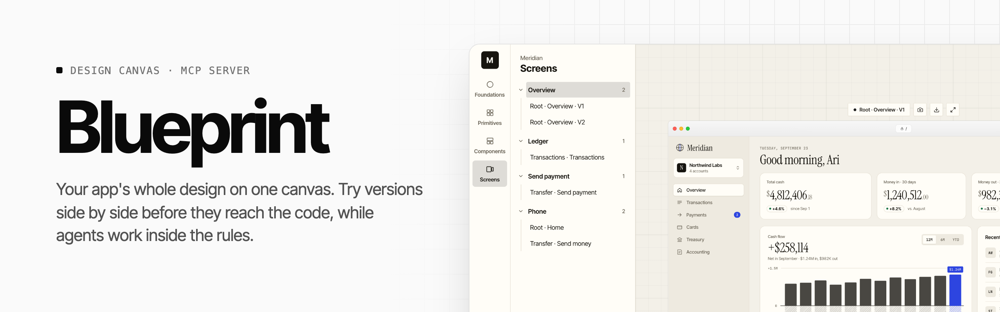
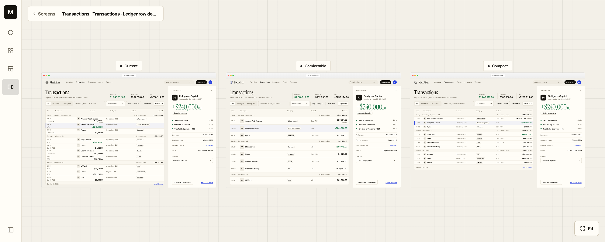

<p align="center">
  
</p>

Blueprint is one top-level view of an app's design: the brand, tokens, primitives, components, and every screen, laid out on a canvas so you can take in the whole thing at once. You and your agents iterate there. Mock up a few versions of a screen, compare them side by side, and pick one before any of it goes into the app's code.

Agents do most of the editing, so Blueprint keeps them inside guardrails. Files have fixed shapes, every reference must point at something declared, and every validation error ends with `Fix:` and the exact change to make.

It runs locally as an MCP server and a review canvas in your browser. The design lives in your app's repository under `design/blueprint/`, as plain JSON, HTML, and CSS. Blueprint is single-project by design, so each app keeps its own.

## How it works

Each app's Blueprint folder is called a sidecar. Structured JSON owns what exists and how it connects: the brand guideline, the tokens, the primitives and components with their variants and states, and the screens grouped into pages. HTML and CSS own how each piece looks. Tokens become CSS custom properties, and screens place components and primitives by reference, so a token or component change shows up everywhere it's used.

The agent edits those files through Blueprint's tools, and Blueprint checks each edit:

- Every sidecar has the closed set of 33 primitives. Apps restyle them through tokens and build anything app-specific as a component.
- Validation rejects fields outside the fixed shapes, undeclared references, literal colors and lengths that should be tokens, hand-built native controls, and low contrast.
- The descriptions agents write for other agents follow Simplified Technical English, with sentences of at most 25 words, so the next agent reads them one way.
- When Blueprint's file format changes, `validate` reports each older file and `serve` shows a notice on the canvas. `serve` with `focus` or `explorationId`, and every other tool that reads the sidecar, refuse it until `migrate` upgrades it.

`serve` opens the canvas. It watches the files and applies each valid edit in place. After each agent turn, a bar lists what changed, such as a component or "Frame sizes", and dashed outlines mark each element whose look changed. Before and After flip between the two. Click anything on the canvas to copy a reference like `primitive:button in section:home/featured in screen:home`, and the agent reads the same selection with the `selection` tool. To stay fast on large projects, the canvas keeps at most 32 frames live and shows a thumbnail for the rest. A frame whose document is over 4 MB shows a title placeholder.

To compare directions, ask the agent for an exploration: two to five versions of one screen, shown next to the current one in their own view.

<p align="center">
  
</p>

Promoting a version makes it the screen and keeps the old one in history, where `restore` can bring it back. When a screen is ready to build, `extract` gives the implementing agent a packet with the screen, every component, primitive, and token it uses, the brand guideline, and the source paths.

## Getting started

You need Node.js 20 or later.

```sh
git clone https://github.com/jlm0/blueprint.git
cd blueprint
npm install
npx playwright install chromium
npm run build
npm run skills:install
```

`skills:install` links the three agent skills in `skills/` into `~/.agents/skills`. Add `-- --target <directory>` to link them somewhere else.

Register the MCP server with your agent host, running from your app's repository root:

```json
{
  "mcpServers": {
    "blueprint": { "command": "node", "args": ["/path/to/blueprint/dist/mcp/server.js"] }
  }
}
```

Then ask the agent to add Blueprint to your app. It runs `init`, which creates `design/blueprint/` with a placeholder brand, neutral tokens, the 33 primitives, and empty phone and web home screens. For a product with no brand yet, `init` with `start: "inspo"` opens an inspo board instead. Paste image links with what you like about each one, and the agent proposes brand directions for you to choose from.

Restart the MCP server after each `npm run build`, because a running server keeps its old tool text and canvas.

## Tools

Blueprint exposes thirteen project-scoped tools:

| Tool | What it does |
| --- | --- |
| `init` | Creates a sidecar from the starter |
| `inspo` | Keeps the inspo board for a new product |
| `validate` | Checks a sidecar in `baseline`, `readiness`, or `strict` mode |
| `migrate` | Upgrades a sidecar to the current file format |
| `index` | Lists every boundary ID, page, and component group |
| `query` | Answers `show`, `uses`, `used-by`, section, exploration, and history questions |
| `extract` | Returns a handoff packet for one boundary |
| `capture` | Renders a screen, component, or primitive to PNG |
| `serve` | Opens the review canvas |
| `selection` | Reads what you selected on the canvas |
| `explore` | Creates or archives a set of versions for one screen |
| `promote` | Makes one version the screen |
| `restore` | Brings back an earlier version from history |

Example calls:

```json
{
  "validate": { "project": "design/blueprint", "mode": "strict" },
  "extract": { "project": "design/blueprint", "boundary": "screen:home", "mode": "deep" },
  "serve": { "project": "design/blueprint", "focus": "component:action-cluster" }
}
```

<details>
<summary>Showing live agent activity in Codex</summary>

The build includes a `blueprint-codex-hook` command that streams tool activity to an open canvas, so the canvas shows what the agent is working on and highlights the boundaries it touches. Register it in the Codex configuration of your app:

```json
{
  "hooks": {
    "PreToolUse": [
      {
        "matcher": "^(functions\\.exec|Bash|apply_patch|Edit|Write|mcp__blueprint__.*)$",
        "hooks": [{ "type": "command", "command": "blueprint-codex-hook", "timeout": 3 }]
      }
    ],
    "PostToolUse": [
      {
        "matcher": "^(functions\\.exec|Bash|apply_patch|Edit|Write|mcp__blueprint__.*)$",
        "hooks": [{ "type": "command", "command": "blueprint-codex-hook", "timeout": 3 }]
      }
    ]
  }
}
```

The hook finds the canvas through an owner-only file in the OS temp directory and signs in with a random token that never reaches the page.

</details>

## Developing Blueprint

`npm run dev` serves the canvas for the starter sidecar at http://127.0.0.1:5173. The sample sidecars in `fixtures/` go from an app built on the starter's own tokens to a full production handoff, and [`fixtures/README.md`](fixtures/README.md) describes each one.

### Repository layout

```text
src/core/       schema types, validation, lints, boundary IDs, queries, extraction packets
src/app/        browser-native canvas (no UI framework)
src/prototype/  source compiler, sandbox host policy, review selection
src/mcp/        MCP tool schemas, operations, capture, and stdio server
src/hooks/      agent activity hook
src/scripts/    fixture validation, extraction, scope scan, browser smoke, skill install
schema/         JSON Schema for sidecar files
skills/         agent skills that skills:install links
starter/        the sidecar that init copies
fixtures/       sample sidecars and a failure catalog
tests/          node:test suites
```

### Scripts

| Command | Runs |
| --- | --- |
| `npm run dev` | Vite dev server for the canvas |
| `npm run lint` | oxlint |
| `npm run typecheck` | `tsc --noEmit` |
| `npm test` | Unit and browser tests |
| `npm run check:fixtures` | Validates every fixture |
| `npm run extract:artifacts` | Writes sample packets under `.blueprint-artifacts/` |
| `npm run scan:scope` | Keeps runtime code free of framework dependencies and app-specific terms |
| `npm run build` | Static canvas and MCP server into `dist/` |
| `npm run smoke:browser` | End-to-end canvas smoke test |
| `npm run qa` | All of the above |

Generated evidence goes to the ignored `.blueprint-artifacts/` directory. Set `BLUEPRINT_ARTIFACT_ROOT` to send it somewhere else.

The prose checks port [asd-ste100-skill](https://github.com/danyuchn/asd-ste100-skill). See [`THIRD_PARTY_NOTICES.md`](THIRD_PARTY_NOTICES.md).
