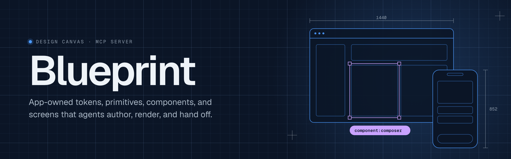
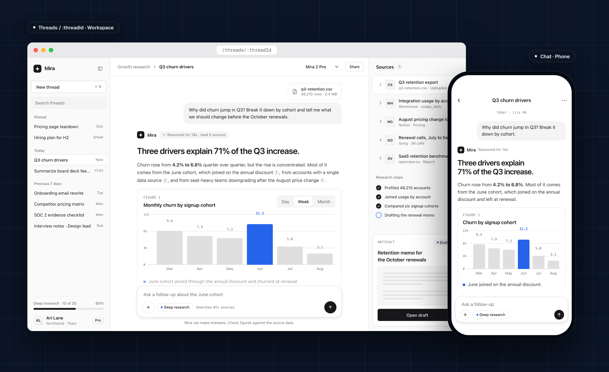

<p align="center">
  
</p>

Blueprint is a local design canvas and MCP server for modeling an app's interface system as app-owned, agent-readable files. It sits beside an agent session: the agent edits tokens, primitives, components, and screens as plain JSON, HTML, and CSS inside the app repository, and Blueprint checks, renders, and hands them off.

Each app keeps its own sidecar, usually under `design/blueprint/`. Blueprint provides the shared pieces: a brand page, pages for each token group, primitive, and component, a canvas of mobile and desktop screen frames for each screen page, token materialization, primitive and component compilation, isolated screen hosting, dependency queries, and extraction packets for implementation handoff. Blueprint is single-project by design. It does not manage a central registry of every app's design system.

## Example: Mira

<p align="center">
  
</p>

[Mira](fixtures/valid/mira-ai/design/blueprint) is an AI research assistant built from the starter's tokens and base primitives, unchanged. Its four components and two screens, a desktop workspace and a phone chat, are the only authored layer, and both frames above are Blueprint renders of those files. [`fixtures/README.md`](fixtures/README.md) covers the other samples: Umbra, an expressive dark retheme, and Meridian, a full strict handoff.

## How it works

Blueprint splits authority between two layers:

- **Structured JSON owns the graph.** Stable IDs, declarations, named states, dependencies, production relationships, targets, and review conditions live in `manifest.json`, `brand.json`, `tokens.json`, `primitives.json`, `components.json`, and `screens.json`.
- **Governed HTML/CSS owns the rendering.** Primitive and component sources define reusable behavior and appearance. Screen sources define unique hierarchy, responsive layout, media, and art direction.

Screenshots and visual diffs are review evidence only, never source.

Screens compose reusable parts with `<blueprint-use kind="primitive|component" ref="…" state="…">`. Blueprint replaces each use with the referenced root, without wrapper elements, so ordinary sibling, flex, grid, and breakpoint rules keep working. A reusable placed inside another reusable's slot is declared by the source that wrote it, so optional pieces compose without changing their container. Tokens become `--app-*` CSS custom properties. Every screen renders in a sandboxed frame with a no-network, no-script content security policy.

Every boundary is addressable as `kind:id`, for example `primitive:button`, `component:email-signup`, `screen:home`, or `section:home/next-action`. Queries return a focused packet for a single boundary; `project:root` carries the brand guideline. Deep extraction adds the transitive screen → component → primitive → token graph, resolved tokens, the brand guideline, and source paths so an implementation agent can build without reading the canvas DOM.

### One sidecar format

Every primitive, component, and screen declares its HTML/CSS source, and the manifest declares a `prototypeHost` policy. Missing or undeclared sources fail validation. Every sidecar carries the closed set of 33 primitives from `src/core/base-primitives.ts`. Apps restyle primitives through tokens and may add variants, sizes, states, and slots above each primitive's floor, but never add or remove primitives: app-specific pieces are components built from primitives. Primitives and components share one JSON shape, one set of rules, and one canvas page.

The prose on primitives and components is written for agents, so validation holds it to the structural rules of Simplified Technical English (ASD-STE100): sentences of at most 25 words, no semicolons, phrasal verbs, marketing adjectives, or nouns standing in for verbs. Blueprint writes the description, accessibility, notes, and value and slot text of its own primitives, and every sidecar carries that text unchanged. Screen copy is not checked. The checks port [asd-ste100-skill](https://github.com/danyuchn/asd-ste100-skill); see [`THIRD_PARTY_NOTICES.md`](THIRD_PARTY_NOTICES.md).

`brand.json` holds the brand guideline: personality, voice, and the marks, wordmarks, and lockups with their approved color variants, clear space, minimum sizes, and usage rules. Marks are SVGs drawn with `currentColor` so token-based variants can recolor them. Screens and components place a mark with `<blueprint-use kind="brand-mark" ref="…" variant="…">`, which inlines the SVG colored by the variant's tokens, so a logo edit reaches every placement the way a token edit does. Foundations opens with the brand, and a strict handoff requires one.

Screens and components are organized like a design file. `screens.json` declares pages, such as Web, Mobile, or Landing, and every screen names its page; each page is its own canvas. `components.json` declares groups, and every component names its group. An agent starting a new page or group must declare it first, and validation rejects undeclared references.

Validation has three modes. `baseline` checks structure. `readiness` reports evidence and pending decisions. `strict` checks the full production handoff contract, including lints for literal colors, lengths that restate tokens, hand-built native controls, unmarked sections, color contrast, and primitives outside the closed set.

## Getting started

Requires Node.js 20 or later.

```sh
npm install
npx playwright install chromium   # used by capture, browser smoke, and canvas tests
npm run dev                       # canvas at http://127.0.0.1:5173 showing the starter sidecar
```

### Connecting an agent

Build the MCP server and static canvas:

```sh
npm run build
```

Then register the stdio server with your agent host, running from the app repository root:

```json
{
  "mcpServers": {
    "blueprint": { "command": "node", "args": ["/path/to/blueprint/dist/mcp/server.js"] }
  }
}
```

The server exposes twelve project-scoped tools:

| Tool | Purpose |
| --- | --- |
| `init` | Create a sidecar from the starter: a placeholder brand, neutral tokens, the 33 primitives, and empty `home` phone and `web-home` browser screens on Mobile and Web pages. |
| `validate` | Check a sidecar in `baseline`, `readiness`, or `strict` mode, and list the design findings the canvas marks and the wording advisories on reusable prose. Every error ends with `Fix:` and the exact change to make. |
| `migrate` | Upgrade a sidecar to the current schema, or report the changes with `dryRun`. It makes every mechanical change and returns the remaining decisions as validation errors. |
| `index` | List every stable boundary ID, plus the declared screen pages and component groups with their members. |
| `query` | Answer focused questions: `show`, `uses`, `used-by`, `sections`, `prototype-only`, explorations, and history. |
| `extract` | Return a `focused` or `deep` handoff packet for a single boundary. |
| `capture` | Render one screen, state, and viewport to PNG, or one component or primitive cropped to its own box. |
| `serve` | Open the live review canvas for the sidecar, optionally linked to one boundary's page with `focus`. |
| `selection` | Read what the person selected on the canvas. |
| `explore` | Create or archive two to five candidate alternatives for a single screen state. |
| `promote` | Make a chosen candidate canonical, guarded by content digests. |
| `restore` | Bring back a prior screen version, preserving the current one in history. |

Example calls:

```json
{
  "init": { "projectId": "my-app", "name": "My App", "out": "design/blueprint" },
  "validate": { "project": "design/blueprint", "mode": "strict" },
  "query": { "project": "design/blueprint", "query": { "type": "used-by", "boundary": "primitive:button" } },
  "extract": { "project": "design/blueprint", "boundary": "screen:home", "mode": "deep" },
  "capture": { "project": "design/blueprint", "boundary": "screen:home", "state": "default", "viewport": "phone", "out": ".blueprint-artifacts/home.png" },
  "serve": { "project": "design/blueprint", "focus": "component:action-cluster" }
}
```

`init` writes an `AGENTS.md` into the new sidecar that describes the working rules for agents editing it.

## The review canvas

`serve` starts one loopback runtime per sidecar and reuses it across MCP connections. The first port tried is 4173. The canvas watches the sidecar's files and applies each valid edit in place, keeping the current page, zoom, and pan. While an edit is invalid, the last good state stays visible.

- **Navigation.** A rail switches between Foundations, Primitives, Components, and Screens. The sub-navigation groups items by declared section or page, and each group collapses. With `focus`, `serve` returns a link that opens one boundary's page; a screen link opens its page and centers the screen.
- **Selection.** Clicking a screen, section, component, or primitive copies a reference such as `primitive:button in section:home/featured in screen:home`. The `selection` tool returns the same reference to the agent, along with the owning source files.
- **Turn changes.** Boundaries that changed during the latest agent turn get a dashed marker, and a brand edit flags the Brand page. Before and After toggle between the turn's starting state and the live project.
- **Findings.** Strict-lint findings appear as counts on screen frames and markers on component instances, each with a copyable remedy. `validate` returns the same list to the agent.
- **Explorations.** Saved alternatives open in an isolated baseline-and-candidates view instead of crowding the canonical screens.

### Live agent activity

Builds include a `blueprint-codex-hook` command that streams tool activity into an open canvas. The canvas then shows what the agent is working on and highlights the boundaries it touches. To enable it, register the hook in the consuming project's Codex configuration:

```json
{
  "hooks": {
    "PreToolUse": [
      {
        "matcher": "^(functions\\.exec|Bash|apply_patch|Edit|Write|mcp__blueprint__.*)$",
        "hooks": [{ "type": "command", "command": "blueprint-codex-hook", "timeout": 3 }]
      }
    ],
    "PostToolUse": [
      {
        "matcher": "^(functions\\.exec|Bash|apply_patch|Edit|Write|mcp__blueprint__.*)$",
        "hooks": [{ "type": "command", "command": "blueprint-codex-hook", "timeout": 3 }]
      }
    ]
  }
}
```

The hook finds the running listener through an owner-only descriptor in the OS temp directory and authenticates with a random per-listener token. The token is never sent to the served page.

## Repository layout

```text
src/core/       schema types, validation, lints, boundary IDs, queries, extraction packets
src/app/        browser-native canvas (no UI framework)
src/prototype/  source compiler, sandbox host policy, capture
src/mcp/        MCP tool schemas, operations, and stdio server
src/hooks/      agent activity hook
src/scripts/    fixture validation, extraction, scope scan, browser smoke
schema/         JSON Schema for sidecar files
starter/        the sidecar that init copies
fixtures/       sample sidecars from neutral to full handoff, plus a failure catalog (see fixtures/README.md)
tests/          node:test suites
```

## Scripts

| Command | Runs |
| --- | --- |
| `npm run dev` | Vite dev server for the canvas |
| `npm run lint` | oxlint |
| `npm run typecheck` | `tsc --noEmit` |
| `npm test` | Unit and browser tests |
| `npm run check:fixtures` | Validates every fixture |
| `npm run extract:artifacts` | Writes sample packets under `.blueprint-artifacts/` |
| `npm run scan:scope` | Keeps runtime code free of framework dependencies and app-specific terms |
| `npm run build` | Static canvas and MCP server into `dist/` |
| `npm run smoke:browser` | End-to-end canvas smoke test |
| `npm run qa` | All of the above |

Generated evidence goes to the ignored `.blueprint-artifacts/` directory. Set `BLUEPRINT_ARTIFACT_ROOT` to send it somewhere else.
